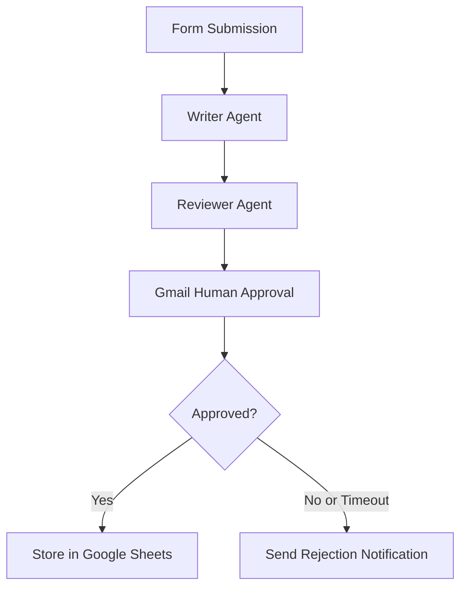

# AI-Powered LinkedIn Post Approval Workflow Using n8n

## Project Overview

This project demonstrates a multi-agent AI automation workflow developed using n8n to generate, review and manage LinkedIn posts with human approval.

The workflow accepts a topic through a form, generates LinkedIn content using a Writer Agent, and improves the content using a Reviewer Agent. The reviewed post is sent through Gmail for human approval before being stored in Google Sheets.

This project demonstrates multi-agent collaboration, Human-in-the-Loop (HITL) automation, conditional decision-making and integration with external applications.

## Objectives

- Automate LinkedIn content generation using AI agents.
- Implement collaboration between Writer and Reviewer Agents.
- Improve content quality, readability and professional tone.
- Implement human approval before storing generated content.
- Handle approval, rejection and timeout scenarios.
- Maintain a centralized tracker for approved posts.

## Technologies Used

| Technology | Purpose |
|---|---|
| n8n | Workflow automation and orchestration |
| OpenAI | AI-powered content generation and review |
| Gmail | Human approval and rejection notifications |
| Google Sheets | Storage and tracking of approved posts |
| n8n Form Trigger | Collecting user input |
| IF Node | Conditional decision-making |
| JSON | Workflow export and portability |

## Workflow Architecture



## Workflow Components

### 1. Form Submission

The workflow starts when the user submits a topic through the n8n form. The submitted topic is passed to the Writer Agent for content generation.

### 2. Writer Agent

The Writer Agent uses an OpenAI Chat Model to generate a professional LinkedIn post based on the submitted topic.

The agent focuses on:

- Relevant content generation.
- Professional writing style.
- Clear and engaging language.
- Appropriate hashtags.
- Structured content.

### 3. Reviewer Agent

The Reviewer Agent receives the content generated by the Writer Agent and evaluates it before sending it for human approval.

The review focuses on:

- Grammar and readability.
- Content relevance.
- Professional tone.
- Clarity and sentence structure.
- Overall content quality.

The improved post is passed to the Gmail approval node.

### 4. Human-in-the-Loop Approval

The reviewed LinkedIn post is sent to the user through Gmail using the Send and Wait for Response operation.

The email provides two options:

- Approve: Accept the generated post.
- Reject: Decline the generated post.

The workflow pauses until the user responds or the configured waiting period expires.

The maximum waiting period is configured as 45 minutes.

### 5. Conditional Decision-Making

An IF node evaluates the approval response using the following expression:

```javascript
{{ $json.data?.approved === true }}
```

Only an explicit approval is considered successful.

- True Branch: Stores the approved post in Google Sheets.
- False Branch: Sends a notification when the post is rejected or approval is not received.

### 6. Google Sheets Integration

Approved LinkedIn posts are stored in a Google Sheets document named LinkedIn Post Approval Tracker.

The Approved Posts sheet contains the following columns:

| Column | Description |
|---|---|
| Topic | Topic submitted by the user |
| Original Post | Content generated by the Writer Agent |
| Reviewed Post | Content improved by the Reviewer Agent |
| Status | Approval status |
| Submitted At | Recorded submission timestamp |
| Approved At | Human approval timestamp |

This provides a centralized record of approved content for future reference.

### 7. Rejection Notification

When a post is rejected or not approved within the configured waiting period, the workflow is designed to send a notification through Gmail.

The notification informs the user that the post has not been saved and that a new topic can be submitted.

## Guardrails and Error Handling

The workflow includes the following controls:

- AI-based content review before human approval.
- Mandatory human approval before storing content.
- Strict Boolean validation of the approval response.
- Handling of missing approval values using optional chaining.
- Configurable approval timeout of 45 minutes.
- Prevention of rejected posts from being stored in Google Sheets.
- Secure credential management through n8n.
- No automatic publishing to LinkedIn.

## Testing and Validation

Functional testing was performed to validate the major workflow components.

| Test Scenario | Expected Result | Status |
|---|---|---|
| Form submission | Topic is passed to the Writer Agent | Passed |
| Content generation | LinkedIn post is generated | Passed |
| Content review | Reviewer Agent improves the generated post | Passed |
| Approval email | Email contains reviewed content and approval buttons | Passed |
| Approve response | Workflow follows the True branch | Passed |
| Google Sheets integration | Approved content is stored successfully | Passed |
| Reject response | Workflow follows the False branch | Passed |
| Rejection notification | Notification email is sent | Passed |
| Approval timeout | Post is not stored without approval | Pending final verification |

## Setup Instructions

1. Set up an n8n cloud or self-hosted instance.
2. Download the workflow JSON file from this repository.
3. Import the JSON file into n8n.
4. Configure the required credentials:
   - OpenAI API credentials.
   - Gmail OAuth2 credentials.
   - Google Sheets OAuth2 credentials.
5. Enable the Google Sheets API and Google Drive API in Google Cloud Console as required.
6. Create a Google Sheets document with the required column headers.
7. Configure the recipient email address in the Gmail nodes.
8. Update the Google Sheets document and sheet details.
9. Execute the workflow and submit a topic through the form.
10. Review the generated content and select Approve or Reject.

## Security Considerations

- API keys and OAuth credentials should be managed securely within n8n.
- Sensitive information should not be hardcoded in workflow expressions.
- Personal email addresses and document identifiers should be removed from publicly shared workflow files.
- Human approval is required before generated content is stored.

## Key Learnings

Through this project, I gained practical experience in:

- Building multi-agent AI workflows using n8n.
- Configuring OpenAI Chat Models.
- Designing prompts for content generation and review.
- Implementing Human-in-the-Loop automation.
- Working with n8n expressions and conditional logic.
- Integrating Gmail and Google Sheets using OAuth credentials.
- Troubleshooting API and permission-related issues.
- Performing functional testing of AI-powered workflows.
- Implementing approval-based guardrails.


## Conclusion

This project demonstrates how multiple AI agents can collaborate within an automated workflow while maintaining human control over the final output.
